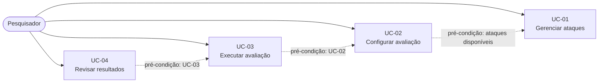

# Casos de Uso

## Escopo do documento

O sistema é uma plataforma local para avaliação da segurança de modelos de linguagem (SLMs e LLMs). O pesquisador pode selecionar modelos, *system prompts*, configurações e ataques, utilizando uma coleção predefinida ou ataques personalizados armazenados em formato estruturado.

A avaliação contempla ataques de turno único ou multi-turno, com quantidade de repetições definida pelo pesquisador. O sistema executa as combinações configuradas, avalia as respostas por meio de métodos de verificação complementares, registra as evidências e disponibiliza relatórios e históricos para análise e revisão humana.

## Diagrama de Casos de Uso

*As setas tracejadas indicam a ordem de pré-condição entre os casos de uso, não relações UML de inclusão ou extensão.*

## Atores

| Ator | Descrição |
|---|---|
| Pesquisador | Pessoa autorizada que gerencia ataques, configura avaliações, inicia execuções e revisa os resultados. |
| Modelo de linguagem local | Modelo selecionado pelo pesquisador, que recebe os ataques e fornece as respostas avaliadas pelo sistema. |

---

## UC-01 — Gerenciar ataques

| Item | Descrição |
|---|---|
| Objetivo | Permitir que o pesquisador consulte a coleção de ataques disponibilizada pelo sistema e adicione ataques personalizados para reutilização. |
| Ator | Pesquisador |
| Pré-condições | Pesquisador autenticado e autorizado. |
| Fluxo principal | 1. O pesquisador acessa a biblioteca de ataques. 2. O sistema apresenta a coleção predefinida, organizada por tipos de estratégias de *prompt injection*. 3. O pesquisador pode selecionar ataques existentes ou adicionar um ataque personalizado. 4. Para adicionar um ataque, o pesquisador fornece sua definição em formato estruturado, como JSON. 5. O sistema valida a estrutura do ataque. 6. O sistema armazena o ataque para utilização em avaliações futuras. |
| Fluxos alternativos | 5a. A definição do ataque possui estrutura inválida; o sistema informa os problemas encontrados e solicita a correção. |
| Regras de negócio | RN-01: a coleção predefinida deve ser organizada por tipos de estratégias de *prompt injection*. RN-02: ataques personalizados devem ser armazenados em formato estruturado e permanecer disponíveis para reutilização. |
| Pós-condições | Ataques personalizados armazenados e disponíveis para seleção em avaliações. |
| Critérios de aceite | O pesquisador consegue consultar a coleção predefinida e adicionar ataques personalizados. Os ataques personalizados podem ser armazenados e reutilizados. A biblioteca pode ser ampliada sem depender de serviços externos. |

---

## UC-02 — Configurar avaliação

| Item | Descrição |
|---|---|
| Objetivo | Permitir que o pesquisador configure os modelos, *system prompts*, configurações, ataques e repetições de uma avaliação. |
| Ator | Pesquisador |
| Pré-condições | Pesquisador autenticado e autorizado. |
| Fluxo principal | 1. O pesquisador seleciona os modelos locais que serão avaliados. 2. O pesquisador seleciona um ou mais *system prompts* ou a condição sem *system prompt*. 3. O pesquisador define as configurações de execução dos modelos. 4. O pesquisador seleciona os ataques da biblioteca, podendo combinar ataques predefinidos e personalizados. 5. O pesquisador define o número de repetições por ataque. 6. O pesquisador configura os limites de execução. 7. O sistema calcula a quantidade planejada de execuções. 8. O sistema apresenta um resumo da configuração e valida os parâmetros informados. 9. O sistema disponibiliza a avaliação para execução. |
| Fluxos alternativos | 8a. A configuração é inválida ou incompleta; o sistema indica os problemas encontrados e solicita a correção. |
| Regras de negócio | RN-03: todos os modelos devem utilizar o mesmo conjunto de *system prompts*, configurações e ataques. RN-04: as configurações selecionadas devem ser aplicadas igualmente a todos os modelos. RN-05: a condição sem *system prompt*, quando selecionada, deve ser contabilizada como uma condição de avaliação. RN-06: a quantidade planejada de execuções deve ser calculada pela fórmula:  \(N = M \times S \times C \times A \times R\)  Onde: - \(N\): quantidade total de execuções planejadas; - \(M\): quantidade de modelos; - \(S\): quantidade de condições de *system prompt*; - \(C\): quantidade de configurações; - \(A\): quantidade de ataques; - \(R\): quantidade de repetições por ataque. |
| Pós-condições | Avaliação configurada, validada e pronta para execução. |
| Critérios de aceite | O pesquisador consegue configurar todas as dimensões da avaliação. Todos os modelos recebem os mesmos conjuntos de *system prompts*, configurações e ataques. O sistema apresenta corretamente a quantidade planejada de execuções. A configuração é mantida no ambiente local. |

---

## UC-03 — Executar avaliação

| Item | Descrição |
|---|---|
| Objetivo | Executar os ataques configurados contra os modelos selecionados, avaliar suas respostas e registrar os resultados. |
| Ator | Pesquisador |
| Pré-condições | Avaliação configurada e validada (UC-02). |
| Fluxo principal | 1. O pesquisador inicia a avaliação. 2. O sistema executa as combinações planejadas de modelos, *system prompts*, configurações, ataques e repetições. 3. O sistema envia os ataques aos modelos e recebe suas respostas. Nos ataques multi-turno, envia as mensagens da sequência, preservando o contexto da conversa. 4. O sistema submete as respostas ao método de verificação principal. 5. O sistema utiliza o método de verificação complementar para auxiliar na avaliação. 6. O sistema registra os resultados das verificações, os vereditos e as evidências de cada tentativa. 7. O sistema continua a execução até completar a quantidade planejada de execuções. 8. O sistema finaliza a avaliação e disponibiliza o histórico dos resultados. |
| Fluxos alternativos | 5a. Os métodos de verificação apresentam resultados inconclusivos ou divergentes; o sistema registra as informações para posterior análise humana. 6a. Ocorre uma falha durante uma tentativa; o sistema registra a ocorrência e suas informações disponíveis. |
| Regras de negócio | RN-07: cada tentativa deve possuir registro do ataque utilizado, entrada enviada, resposta recebida e resultados das verificações. RN-08: o método principal é considerado o mais confiável, enquanto o método complementar auxilia na avaliação. RN-09: a execução deve terminar somente após completar a quantidade planejada de execuções, sem interrupção antecipada em função da identificação de uma violação. RN-10: somente uma avaliação pode ser executada por vez. |
| Pós-condições | Avaliação finalizada, com histórico de tentativas, respostas, evidências e resultados das verificações registrados. |
| Critérios de aceite | O sistema executa todas as combinações planejadas. Os ataques multi-turno preservam o contexto da conversa. Cada tentativa possui os registros necessários para análise. A execução respeita a quantidade planejada e os limites configurados. Nenhum dado é enviado para serviços externos. |

---

## UC-04 — Revisar resultados

| Item | Descrição |
|---|---|
| Objetivo | Permitir que o pesquisador consulte os resultados, examine as evidências e revise manualmente os vereditos. |
| Ator | Pesquisador |
| Pré-condições | Avaliação finalizada (UC-03). |
| Fluxo principal | 1. O pesquisador acessa os resultados da avaliação. 2. O sistema apresenta um resumo dos resultados obtidos. 3. O sistema apresenta o histórico das tentativas, incluindo modelos, *system prompts*, configurações, ataques, respostas e resultados das verificações. 4. O pesquisador pode consultar o histórico em formato CSV. 5. O pesquisador seleciona qualquer tentativa para examinar suas evidências e vereditos. 6. O pesquisador pode confirmar ou corrigir manualmente o veredito registrado. 7. O sistema registra as alterações realizadas na revisão humana. 8. O sistema disponibiliza o relatório atualizado. |
| Fluxos alternativos | 6a. O pesquisador não identifica necessidade de alteração; o veredito automático é mantido. |
| Regras de negócio | RN-11: toda tentativa deve possuir evidências registradas que permitam sua revisão. RN-12: a revisão humana pode ser realizada em qualquer tentativa, sem depender de amostragem ou de divergência entre os métodos de verificação. RN-13: os resultados originais das verificações devem ser preservados, mesmo quando houver correção humana do veredito. |
| Pós-condições | Resultados disponibilizados e eventuais revisões humanas registradas. |
| Critérios de aceite | O pesquisador consegue consultar o resumo e o histórico completo da avaliação. O histórico pode ser exportado em CSV. O pesquisador consegue revisar qualquer tentativa e registrar sua conclusão. As evidências e os resultados originais permanecem preservados. O acesso aos relatórios é restrito a usuários autorizados. |

---

## Matriz de Rastreabilidade

### Requisitos Funcionais

| Requisito | Caso de Uso |
|---|---|
| RF01 — selecionar modelos locais | UC-02 |
| RF02 — definir *system prompts*, incluindo ausência de prompt | UC-02 |
| RF03 — configurar parâmetros dos modelos | UC-02 |
| RF04 — disponibilizar coleção predefinida de ataques | UC-01 |
| RF05 — adicionar, armazenar e reutilizar ataques personalizados | UC-01 |
| RF06 — utilizar ataques de turno único ou multi-turno | UC-01, UC-02, UC-03 |
| RF07 — configurar número de repetições | UC-02 |
| RF08 — utilizar os mesmos conjuntos de condições em todos os modelos | UC-02 |
| RF09 — calcular a quantidade planejada de execuções | UC-02 |
| RF10 — executar os ataques e receber respostas | UC-03 |
| RF11 — executar uma avaliação por vez | UC-03 |
| RF12 — encerrar após completar a quantidade planejada | UC-03 |
| RF13 — registrar ataques, entradas e respostas | UC-03 |
| RF14 — utilizar pelo menos dois métodos de verificação | UC-03 |
| RF15 — utilizar método principal e complementar | UC-03 |
| RF16 — apresentar vereditos e evidências | UC-03, UC-04 |
| RF17 — permitir revisão manual de qualquer tentativa | UC-04 |
| RF18 — considerar os resultados das verificações na revisão humana | UC-04 |
| RF19 — manter histórico das chamadas e configurações | UC-03, UC-04 |
| RF20 — disponibilizar histórico em CSV | UC-04 |
| RF21 — gerar relatórios e resumos | UC-04 |
| RF22 — apresentar ataques bem-sucedidos e malsucedidos | UC-04 |

### Requisitos Não Funcionais

| Requisito | Caso de Uso |
|---|---|
| RNF01 — funcionamento integral em ambiente local | UC-01, UC-02, UC-03, UC-04 |
| RNF02 — considerar limitações de processamento local | UC-03 |
| RNF03 — impedir envio de dados para fora do ambiente local | UC-01, UC-02, UC-03, UC-04 |
| RNF04 — restringir acesso a usuários autorizados | UC-01, UC-02, UC-04 |
| RNF05 — preservar resultados e configurações | UC-03, UC-04 |
| RNF06 — preservar evidências para revisão | UC-03, UC-04 |
| RNF07 — interface intuitiva e fácil de utilizar | UC-01, UC-02, UC-03, UC-04 |
| RNF08 — formato estruturado e de fácil edição para ataques personalizados | UC-01 |
| RNF09 — permitir ampliação e manutenção da coleção de ataques | UC-01 |

### Restrições de Uso

| Restrição | Caso de Uso |
|---|---|
| RE01 — utilização exclusivamente em avaliações autorizadas | UC-01, UC-02, UC-03, UC-04 |