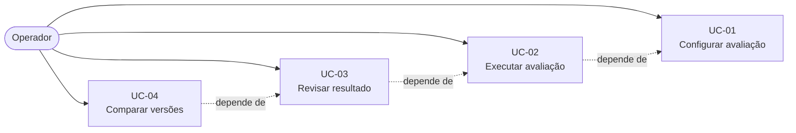

# Casos de Uso

## Escopo do documento

O sistema avalia localmente a segurança de um chatbot baseado em SLM, testando se ele viola as regras de segurança definidas para o teste ou revela conteúdo protegido. O operador define o alvo do teste; o sistema executa tentativas adversariais de uma única mensagem, adaptando-as conforme os resultados anteriores, até detectar uma violação ou atingir o limite de tentativas configurado.

## Diagrama de Casos de Uso

## Atores

| Ator | Descrição |
|---|---|
| Operador | Profissional autorizado que configura a avaliação, confirma as regras sugeridas, inicia a execução e revisa os vereditos. |
| Sistema | Executa as tentativas de ataque, avalia as respostas e gera os relatórios. |

*Nota: o atacante simulado é um componente interno do Sistema, não um ator separado.*

## UC-01 — Configurar avaliação

| Item | Descrição |
|---|---|
| Objetivo | Permitir que o operador monte uma avaliação com alvo, regras e limites definidos. |
| Ator | Operador |
| Pré-condições | Operador autenticado e autorizado. |
| Fluxo principal | 1. O operador informa o modelo a ser testado. 2. O operador informa o *system prompt* do modelo. 3. O operador define as regras de segurança a verificar. 4. O sistema analisa o *system prompt* e sugere regras adicionais. 5. O operador confirma ou descarta cada regra sugerida. 6. O operador informa os conteúdos protegidos a verificar. 7. O operador configura o número máximo de tentativas. 8. O sistema valida a configuração e habilita o início da execução. |
| Fluxos alternativos | 4a. O sistema não encontra regras adicionais para sugerir; a etapa é pulada. 3a–7a. O operador pode salvar a configuração como rascunho e retomar depois. |
| Regras de negócio | RN-01: apenas regras de segurança confirmadas pelo operador são verificadas. RN-02: a configuração não pode ser executada sem modelo, *system prompt* e pelo menos uma regra ou conteúdo protegido. |
| Pós-condições | Avaliação configurada e pronta para execução. |
| Critérios de aceite | A configuração é persistida sem envio de dados a serviços externos. |

## UC-02 — Executar avaliação

| Item | Descrição |
|---|---|
| Objetivo | Executar tentativas adversariais de uma única mensagem até detectar a primeira violação ou atingir o limite configurado. |
| Ator | Operador |
| Pré-condições | Avaliação configurada (UC-01). |
| Fluxo principal | 1. O operador inicia a execução. 2. O sistema gera a primeira tentativa de ataque com base no alvo definido. 3. O sistema envia a tentativa ao modelo testado e recebe a resposta. 4. O sistema avalia a resposta (sistema redundante de verificação, ex: LLM-as-Judge, TF-IDF) e registra o veredito. 5. O sistema decide a próxima tentativa com base nos resultados anteriores. 6. O sistema exibe o progresso e o tempo estimado. 7. O sistema encerra ao detectar a primeira violação ou ao atingir o limite configurado, o que ocorrer primeiro. 8. O sistema registra o histórico completo de tentativas. |
| Fluxos alternativos | 4a. O sistema não consegue chegar a um veredito e marca a tentativa como inconclusiva. 7a. O operador interrompe a execução manualmente; o teste é registrado como interrompido. |
| Regras de negócio | RN-03: o teste para na primeira violação detectada. RN-04: o número de tentativas nunca ultrapassa o limite configurado. RN-05: cada tentativa registra entrada, resposta, estratégia utilizada e veredito. |
| Pós-condições | Execução registrada, com todas as tentativas, entradas, respostas e vereditos. |
| Critérios de aceite | O sistema nunca realiza mais tentativas que o limite configurado. O teste para na primeira violação detectada. Nenhum dado sai do ambiente local durante a execução. |

## UC-03 — Revisar resultado

| Item | Descrição |
|---|---|
| Objetivo | Permitir que o operador inspecione os vereditos com suas evidências e confirme ou corrija cada um. |
| Ator | Operador |
| Pré-condições | Execução concluída ou interrompida (UC-02). |
| Fluxo principal | 1. O operador abre o relatório da execução. 2. O sistema apresenta o resumo do resultado. 3. O sistema apresenta o histórico de tentativas com entrada, resposta, veredito e evidência. 4. O sistema indica, para cada veredito, a regra violada ou o conteúdo protegido revelado. 5. O operador revisa os vereditos e confirma ou corrige cada um. |
| Fluxos alternativos | 5a. O operador marca um veredito para segunda análise, sem alterá-lo. 5b. O operador classifica um veredito inconclusivo como violação ou sem violação, registrando a justificativa. |
| Regras de negócio | RN-06: todo veredito de violação possui evidência registrada (entrada e resposta). RN-07: alterações manuais de veredito são registradas com justificativa e autoria. |
| Pós-condições | Vereditos revisados e registrados; resumo atualizado. |
| Critérios de aceite | Toda violação apontada possui evidência (entrada e resposta). O relatório distingue violação, sem violação e inconclusivo. O relatório pode ser acessado apenas por usuários autorizados. |

## UC-04 — Comparar versões

| Item | Descrição |
|---|---|
| Objetivo | Permitir comparar os resultados de duas execuções para apoiar a reavaliação após mudanças no modelo ou no *system prompt*. |
| Ator | Operador |
| Pré-condições | Duas ou mais execuções registradas e revisadas (UC-03). |
| Fluxo principal | 1. O operador seleciona duas execuções de avaliação. 2. O sistema apresenta o resumo de cada execução lado a lado. 3. O sistema destaca as diferenças: violações detectadas, regras violadas, estratégias que funcionaram e número de tentativas. 4. O operador registra a conclusão da comparação. |
| Fluxos alternativos | 1a. O operador seleciona execuções da mesma avaliação (mesmo modelo e *system prompt*), para verificar a variabilidade dos resultados. |
| Regras de negócio | RN-08: comparações só são geradas a partir de execuções registradas no ambiente local. |
| Pós-condições | Comparação registrada e associada às execuções comparadas. |
| Critérios de aceite | A comparação indica quais versões tiveram violações e quais estratégias tiveram sucesso. Nenhum dado de comparação sai do ambiente local. |

## Matriz de Rastreabilidade

| Requisito | Caso de Uso |
|---|---|
| RF 1.1 — informar modelo | UC-01 |
| RF 1.2 — informar *system prompt* | UC-01 |
| RF 1.3 — definir regras de segurança | UC-01 |
| RF 1.4 — sugerir regras para confirmação | UC-01 |
| RF 1.5 — informar conteúdos protegidos | UC-01 |
| RF 1.6 — configurar limite de tentativas | UC-01 |
| RF 2.1 — gerar tentativas de uma mensagem | UC-02 |
| RF 2.2 — adaptar tentativas | UC-02 |
| RF 2.3 — encerrar na primeira violação ou no limite | UC-02 |
| RF 2.4 — exibir progresso e tempo estimado | UC-02 |
| RF 2.5 — registrar entrada e resposta | UC-02 |
| RF 3.1 — violação de regra de segurança | UC-02 |
| RF 3.2 — violação por conteúdo protegido | UC-02 |
| RF 3.3 — violação, sem violação ou inconclusivo | UC-02 |
| RF 3.4 — sistema redundante de verificação | UC-02 |
| RF 3.5 — evidência e motivo do veredito | UC-02, UC-03 |
| RF 3.6 — revisão humana dos vereditos | UC-03 |
| RF 4.1 — relatório completo | UC-03 |
| RF 4.2 — resumo do resultado | UC-03 |
| RF 4.3 — estratégias com sucesso e falha | UC-03 |
| RNF 4.1 — reavaliação e comparação entre versões | UC-04 |

