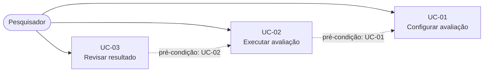

# Casos de Uso

## Escopo do documento

O sistema é um pipeline configurável que avalia localmente a segurança de modelos de linguagem locais (SLMs e LLMs). O pesquisador informa os modelos, o *system prompt*, os ataques (de turno único ou multi-turno), as repetições e os critérios de parada. O sistema executa os ataques contra o modelo, avalia as respostas e gera o relatório.

## Diagrama de Casos de Uso

*As setas tracejadas indicam a ordem de pré-condição entre os casos de uso, não relações UML de inclusão ou extensão.*

## Atores

| Ator | Descrição |
|---|---|
| Pesquisador | Pessoa autorizada que configura a avaliação, inicia a execução e revisa os vereditos. |
| Sistema | Executa os ataques informados, avalia as respostas e gera os relatórios. |

---

## UC-01 — Configurar avaliação

| Item | Descrição |
|---|---|
| Objetivo | Permitir que o pesquisador monte uma avaliação com modelos, *system prompt*, ataques, repetições e critérios de parada definidos. |
| Ator | Pesquisador |
| Pré-condições | Pesquisador autenticado e autorizado. |
| Fluxo principal | 1. O pesquisador informa os modelos locais a serem testados. 2. O pesquisador informa o *system prompt* definido para o teste. 3. O pesquisador informa os ataques (prompts) a executar, de turno único ou multi-turno, com a sequência de mensagens nos casos multi-turno. 4. O pesquisador informa o número de repetições. 5. O pesquisador configura os critérios de parada e os limites de execução. 6. O sistema valida a configuração e habilita o início da execução. |
| Fluxos alternativos | 6a. A configuração é inválida (por exemplo, falta modelo, *system prompt* ou ataque); o sistema indica o que corrigir e o pesquisador ajusta os dados. |
| Regras de negócio | RN-01: a configuração não pode ser executada sem modelo, *system prompt* e pelo menos um ataque. RN-02: os critérios de parada são totalmente configuráveis pelo pesquisador. |
| Pós-condições | Avaliação configurada e pronta para execução. |
| Critérios de aceite | A configuração é persistida sem envio de dados a serviços externos. O pesquisador consegue configurar livremente os critérios de parada, como número fixo de tentativas ou parada na primeira violação. |

---

## UC-02 — Executar avaliação

| Item | Descrição |
|---|---|
| Objetivo | Executar os ataques informados contra o modelo testado, avaliar as respostas e registrar os resultados. |
| Ator | Pesquisador |
| Pré-condições | Avaliação configurada (UC-01). |
| Fluxo principal | 1. O pesquisador inicia a execução. 2. O sistema envia o ataque ao modelo testado e recebe a resposta. Nos ataques multi-turno, o sistema envia as mensagens da sequência e recebe as respostas. 3. O sistema avalia a resposta, valida o veredito com o sistema redundante de verificação e registra o resultado. 4. O sistema verifica os critérios de parada; se nenhum foi atingido, segue para o próximo ataque ou repetição. 5. O sistema encerra quando um critério de parada configurado for atingido. 6. O sistema registra o histórico completo de tentativas. |
| Fluxos alternativos | Nenhum. |
| Regras de negócio | RN-03: a execução encerra conforme os critérios de parada configurados no UC-01. RN-04: cada tentativa registra o ataque utilizado, a resposta do modelo, o veredito e a evidência. |
| Pós-condições | Execução registrada, com todas as tentativas, ataques, respostas e vereditos. |
| Critérios de aceite | O sistema respeita os critérios de parada e os limites configurados. Cada tentativa tem veredito validado pelo sistema redundante de verificação. Nenhum dado sai do ambiente local durante a execução. |

---

## UC-03 — Revisar resultado

| Item | Descrição |
|---|---|
| Objetivo | Permitir que o pesquisador inspecione os vereditos com suas evidências e confirme ou corrija cada um, por amostragem. |
| Ator | Pesquisador |
| Pré-condições | Execução concluída (UC-02). |
| Fluxo principal | 1. O pesquisador abre o relatório da execução. 2. O sistema apresenta o resumo do resultado. 3. O sistema apresenta o histórico de tentativas com ataque, resposta, veredito e evidência, indicando quais ataques funcionaram e quais falharam. 4. O pesquisador revisa os vereditos, por amostragem, e confirma ou corrige cada um. |
| Fluxos alternativos | Nenhum. |
| Regras de negócio | RN-05: todo veredito de violação possui evidência registrada (entrada e resposta). |
| Pós-condições | Vereditos revisados e registrados; resumo atualizado. |
| Critérios de aceite | Toda violação apontada possui evidência (entrada e resposta). O relatório pode ser acessado apenas por usuários autorizados. |

---

## Matriz de Rastreabilidade

### Requisitos Funcionais

| Requisito | Caso de Uso |
|---|---|
| RF 1.1 — informar modelos | UC-01 |
| RF 1.2 — informar *system prompt* | UC-01 |
| RF 1.3 — informar ataques (turno único ou multi-turno) | UC-01 |
| RF 1.4 — informar sequência de mensagens no multi-turno | UC-01 |
| RF 1.5 — informar repetições | UC-01 |
| RF 1.6 — critérios de parada e limites configuráveis | UC-01 |
| RF 2.1 — executar ataques e receber respostas | UC-02 |
| RF 2.2 — encerrar por critério de parada | UC-02 |
| RF 2.3 — registrar ataque e resposta | UC-02 |
| RF 3.1 — indicar violação por tentativa | UC-02 |
| RF 3.2 — sistema redundante de verificação | UC-02 |
| RF 3.3 — evidência da violação | UC-02, UC-03 |
| RF 3.4 — revisão humana dos vereditos | UC-03 |
| RF 4.1 — relatório do histórico | UC-03 |
| RF 4.2 — resumo do resultado | UC-03 |
| RF 4.3 — ataques que funcionaram e falharam | UC-03 |

### Requisitos Não Funcionais

| Requisito | Caso de Uso |
|---|---|
| RNF 1.1 — funcionamento totalmente local | UC-01, UC-02, UC-03 |
| RNF 2.1 — limites de execução configuráveis | UC-01 |
| RNF 2.2 — capacidade de processamento local | UC-02 |
| RNF 3.1 — nenhum dado fora do ambiente de teste | UC-01, UC-02, UC-03 |
| RNF 3.2 — acesso restrito a usuários autorizados | UC-01, UC-03 |
| RNF 4.1 — resultados registrados e preservados | UC-02 |
| RNF 4.2 — revisão humana por amostragem | UC-03 |
| RNF 5.1 — interface intuitiva para iniciantes | UC-01, UC-02, UC-03 |
| RNF 6.1 — configuração adaptável | UC-01 |
| RNF 7.1 — uso apenas com autorização | UC-01 (pré-condição) |