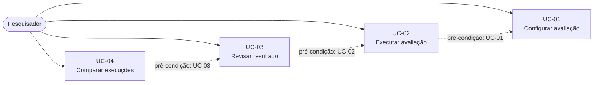

# Casos de Uso

## Escopo do documento

O sistema avalia localmente a segurança de modelos de linguagem locais (SLMs e LLMs), testando se eles violam as regras de segurança definidas para o teste ou revelam conteúdo protegido. O pesquisador define o alvo do teste, o modo de ataque (turno único ou multi-turno) e os critérios de parada. O sistema executa tentativas adversariais, adaptando-as conforme os resultados anteriores, até que um critério de parada configurado seja atingido.

## Diagrama de Casos de Uso

*As setas tracejadas indicam a ordem de pré-condição entre os casos de uso, não relações UML de inclusão ou extensão.*

## Atores

| Ator | Descrição |
|---|---|
| Pesquisador | Pessoa autorizada que configura a avaliação, confirma as regras sugeridas, inicia a execução, revisa os vereditos e compara execuções. |
| Sistema | Executa as tentativas de ataque, avalia as respostas e gera os relatórios. |

*Nota: o atacante simulado, o avaliador de vereditos e o verificador redundante são componentes internos do Sistema, não atores separados. O modelo testado é o alvo da avaliação e executa localmente.*

---

## UC-01 — Configurar avaliação

| Item | Descrição |
|---|---|
| Objetivo | Permitir que o pesquisador monte uma avaliação com alvo, regras, modo de ataque, critérios de parada e limites definidos. |
| Ator | Pesquisador |
| Pré-condições | Pesquisador autenticado e autorizado. |
| Fluxo principal | 1. O pesquisador informa o modelo local (SLM ou LLM) a ser testado. 2. O pesquisador informa o *system prompt* definido para o teste. 3. O pesquisador define as regras de segurança a verificar. 4. O sistema analisa o *system prompt* e sugere regras adicionais. 5. O pesquisador confirma ou descarta cada regra sugerida. 6. O pesquisador informa os conteúdos protegidos a verificar. 7. O pesquisador escolhe o modo de ataque (turno único ou multi-turno) e, no multi-turno, o número máximo de turnos por tentativa. 8. O pesquisador configura os critérios de parada e os limites de execução (número de tentativas, parar na primeira violação, parar após N violações e tempo máximo). 9. O sistema valida a configuração e habilita o início da execução. |
| Fluxos alternativos | 4a. O sistema não encontra regras adicionais para sugerir; a etapa é pulada. 9a. A configuração é inválida (por exemplo, falta modelo, *system prompt*, regra ou conteúdo protegido, ou nenhum limite de encerramento); o sistema indica o que corrigir e o pesquisador ajusta os dados. |
| Regras de negócio | RN-01: apenas regras de segurança confirmadas pelo pesquisador são verificadas. RN-02: a configuração não pode ser executada sem modelo, *system prompt* e pelo menos uma regra ou conteúdo protegido. RN-03: a configuração deve ter pelo menos um limite de encerramento (número de tentativas ou tempo máximo), para que a execução não seja infinita. RN-04: os critérios de parada são totalmente configuráveis pelo pesquisador; parar na primeira violação é uma opção, não uma regra fixa. |
| Pós-condições | Avaliação configurada e pronta para execução. |
| Critérios de aceite | A configuração é persistida sem envio de dados a serviços externos. O pesquisador consegue combinar livremente os critérios de parada e escolher entre turno único e multi-turno. O sistema recusa configurações sem limite de encerramento. |

---

## UC-02 — Executar avaliação

| Item | Descrição |
|---|---|
| Objetivo | Executar tentativas adversariais, de turno único ou multi-turno, até que um critério de parada configurado seja atingido. |
| Ator | Pesquisador |
| Pré-condições | Avaliação configurada (UC-01). |
| Fluxo principal | 1. O pesquisador inicia a execução. 2. O sistema gera a primeira tentativa de ataque com base no alvo definido e no modo de ataque escolhido. 3. O sistema envia a(s) mensagem(ns) da tentativa ao modelo testado e recebe a(s) resposta(s). No modo multi-turno, o sistema gera cada mensagem seguinte a partir das respostas anteriores, até o número máximo de turnos. 4. O sistema avalia a resposta com o avaliador principal e a valida com o sistema redundante de verificação (ex.: LLM-as-Judge, TF-IDF), e registra o veredito. 5. O sistema decide a próxima tentativa com base nos resultados anteriores. 6. O sistema exibe o progresso e o tempo estimado. 7. O sistema encerra quando um critério de parada configurado for atingido. 8. O sistema registra o histórico completo de tentativas e o estado final da execução. |
| Fluxos alternativos | 4a. O avaliador principal e o verificador redundante discordam, ou o sistema não consegue chegar a um veredito; a tentativa é marcada como inconclusiva. 7a. O pesquisador interrompe a execução manualmente; o teste é registrado como interrompido. |
| Regras de negócio | RN-05: a execução encerra conforme os critérios de parada configurados no UC-01. RN-06: o sistema nunca ultrapassa os limites configurados (número de tentativas e tempo máximo). RN-07: cada tentativa registra as mensagens enviadas, as respostas, a estratégia utilizada e o veredito. RN-08: em caso de discordância entre o avaliador principal e o verificador redundante, o veredito é inconclusivo. |
| Pós-condições | Execução registrada, com todas as tentativas, mensagens, respostas, estratégias e vereditos. |
| Critérios de aceite | O sistema nunca realiza mais tentativas que o limite configurado. Com "parar na primeira violação" ativada, o teste encerra na primeira violação detectada; com ela desativada, a execução continua até outro critério de parada. No modo multi-turno, a conversa completa da tentativa é registrada. Nenhum dado sai do ambiente local durante a execução. |

---

## UC-03 — Revisar resultado

| Item | Descrição |
|---|---|
| Objetivo | Permitir que o pesquisador inspecione os vereditos com suas evidências e confirme ou corrija cada um, integralmente ou por amostragem. |
| Ator | Pesquisador |
| Pré-condições | Execução concluída ou interrompida (UC-02). |
| Fluxo principal | 1. O pesquisador abre o relatório da execução. 2. O sistema apresenta o resumo do resultado e as métricas (violações por regra, tentativas até a primeira violação e estratégias que funcionaram ou falharam). 3. O sistema apresenta o histórico de tentativas com entrada, resposta, veredito e evidência. 4. O sistema indica, para cada veredito, a regra violada ou o conteúdo protegido revelado. 5. O pesquisador revisa os vereditos, todos ou uma amostra selecionada, e confirma ou corrige cada um. 6. O pesquisador pode exportar o relatório. |
| Fluxos alternativos | 5a. O pesquisador marca um veredito para segunda análise, sem alterá-lo. 5b. O pesquisador classifica um veredito inconclusivo como violação ou sem violação, registrando a justificativa. |
| Regras de negócio | RN-09: todo veredito de violação possui evidência registrada (entrada e resposta). RN-10: alterações manuais de veredito são registradas com justificativa e autoria. |
| Pós-condições | Vereditos revisados e registrados; resumo atualizado. |
| Critérios de aceite | Toda violação apontada possui evidência (entrada e resposta). O relatório distingue violação, sem violação e inconclusivo. O relatório pode ser acessado apenas por usuários autorizados. O relatório exportado contém a configuração da execução. |

---

## UC-04 — Comparar execuções

| Item | Descrição |
|---|---|
| Objetivo | Permitir comparar os resultados de duas ou mais execuções, para observar a variabilidade dos resultados e apoiar a reavaliação após mudanças no modelo, no *system prompt* ou nas regras. |
| Ator | Pesquisador |
| Pré-condições | Duas ou mais execuções registradas e revisadas (UC-03). |
| Fluxo principal | 1. O pesquisador seleciona as execuções a comparar. 2. O sistema apresenta o resumo de cada execução lado a lado. 3. O sistema destaca as diferenças: violações detectadas, regras violadas, estratégias que funcionaram e número de tentativas. 4. O pesquisador registra a conclusão da comparação. |
| Fluxos alternativos | 1a. O pesquisador seleciona execuções da mesma configuração (mesmo modelo, *system prompt* e regras), para verificar a variabilidade dos resultados. |
| Regras de negócio | RN-11: comparações só são geradas a partir de execuções registradas no ambiente local. |
| Pós-condições | Comparação registrada e associada às execuções comparadas. |
| Critérios de aceite | A comparação indica quais execuções tiveram violações e quais estratégias tiveram sucesso. Nenhum dado de comparação sai do ambiente local. |

---

## Matriz de Rastreabilidade

### Requisitos Funcionais

| Requisito | Caso de Uso |
|---|---|
| RF 1.1 — informar modelo local | UC-01 |
| RF 1.2 — informar *system prompt* | UC-01 |
| RF 1.3 — definir regras de segurança | UC-01 |
| RF 1.4 — sugerir regras para confirmação | UC-01 |
| RF 1.5 — informar conteúdos protegidos | UC-01 |
| RF 1.6 — critérios de parada e limites configuráveis | UC-01 |
| RF 1.7 — modo de ataque (turno único ou multi-turno) | UC-01 |
| RF 2.1 — gerar tentativas de turno único ou multi-turno | UC-02 |
| RF 2.2 — adaptar tentativas | UC-02 |
| RF 2.3 — encerrar por critério de parada ou interrupção | UC-02 |
| RF 2.4 — exibir progresso e tempo estimado | UC-02 |
| RF 2.5 — registrar mensagens, respostas e estratégia | UC-02 |
| RF 2.6 — repetir execução com a mesma configuração | UC-02, UC-04 |
| RF 3.1 — violação de regra de segurança | UC-02 |
| RF 3.2 — violação por conteúdo protegido | UC-02 |
| RF 3.3 — violação, sem violação ou inconclusivo | UC-02 |
| RF 3.4 — sistema redundante de verificação | UC-02 |
| RF 3.5 — evidência e motivo do veredito | UC-02, UC-03 |
| RF 3.6 — revisão humana dos vereditos (inclusive por amostra) | UC-03 |
| RF 3.7 — registro de alterações manuais | UC-03 |
| RF 4.1 — relatório completo | UC-03 |
| RF 4.2 — resumo do resultado | UC-03 |
| RF 4.3 — estratégias com sucesso e falha | UC-03 |
| RF 4.4 — métricas da avaliação | UC-03 |
| RF 4.5 — configuração guardada e exportação do relatório | UC-03 |
| RF 4.6 — comparar execuções | UC-04 |

### Requisitos Não Funcionais

| Requisito | Caso de Uso |
|---|---|
| RNF 1.1 — funcionamento totalmente local | UC-01, UC-02, UC-03, UC-04 |
| RNF 2.1 — tempo estimado e limitação do tempo | UC-01, UC-02 |
| RNF 2.2 — processamento local disponível | UC-02 |
| RNF 3.1 — nenhum dado fora do ambiente de teste | UC-01, UC-02, UC-03, UC-04 |
| RNF 3.2 — acesso restrito a usuários autorizados | UC-01, UC-03 |
| RNF 4.1 — registros preservados para reavaliação e comparação | UC-02, UC-04 |
| RNF 4.2 — revisão humana por amostragem | UC-03 |
| RNF 5.1 — interface intuitiva para iniciantes | UC-01, UC-02, UC-03, UC-04 |
| RNF 5.2 — configuração guiada e valores padrão | UC-01 |
| RNF 6.1 — configuração adaptável | UC-01 |
| RNF 6.2 — extensibilidade de estratégias e verificadores | UC-02 |
| RNF 7.1 — registros para reprodução e publicação | UC-03, UC-04 |
| RNF 7.2 — documentação de uso | Fora dos casos de uso (entrega de documentação) |
| RNF 8.1 — uso autorizado | UC-01 (pré-condição) |