# Diagrama UML de Processos

## Objetivo

Este diagrama representa o processo de avaliação local de segurança de um chatbot baseado em SLM, desde a configuração pelo operador até a revisão do relatório e, opcionalmente, a comparação entre execuções.

## Diagrama de atividades

O diagrama representa as atividades do **Operador** e do **Sistema**. Cada tentativa contém uma única mensagem. A execução termina na primeira violação, ao atingir o limite configurado ou quando o operador a interrompe.

```mermaid
flowchart TD
    INICIO([Início]) --> CONFIG["Operador: informar modelo, system prompt e regras"]
    CONFIG --> ANALISAR["Sistema: analisar system prompt"]
    ANALISAR --> SUGESTOES{"Há regras adicionais para sugerir?"}
    SUGESTOES -->|Sim| CONFIRMAR["Operador: confirmar ou descartar sugestões"]
    SUGESTOES -->|Não| PROTEGER
    CONFIRMAR --> PROTEGER["Operador: informar conteúdos protegidos e limite de tentativas"]
    PROTEGER --> VALIDAR["Sistema: validar configuração"]
    VALIDAR --> VALIDA{"Configuração válida?"}
    VALIDA -->|Não| CORRIGIR["Operador: corrigir dados obrigatórios"]
    CORRIGIR --> VALIDAR
    VALIDA -->|Sim| INICIAR["Operador: iniciar avaliação"]
    INICIAR --> HISTORICO["Sistema: inicializar execução e histórico"]
    HISTORICO --> GERAR["Gerar tentativa adaptada de uma mensagem"]
    GERAR --> ENVIAR["Enviar tentativa ao modelo local"]
    ENVIAR --> RESPOSTA["Receber resposta do modelo"]
    RESPOSTA --> AVALIAR["Avaliar resposta e determinar veredito"]
    AVALIAR --> REGISTRAR["Registrar entrada, resposta, estratégia, veredito e evidências"]
    REGISTRAR --> PROGRESSO["Atualizar progresso e tempo estimado"]
    PROGRESSO --> VIOLACAO{"Foi detectada violação?"}
    VIOLACAO -->|Sim| FINALIZAR["Registrar estado final da execução"]
    VIOLACAO -->|Não| INTERROMPER{"Operador interrompeu o teste?"}
    INTERROMPER -->|Sim| FINALIZAR
    INTERROMPER -->|Não| LIMITE{"Limite de tentativas atingido?"}
    LIMITE -->|Sim| FINALIZAR
    LIMITE -->|Não| GERAR
    FINALIZAR --> RELATORIO["Gerar resumo e relatório do histórico"]
    RELATORIO --> REVISAR["Operador: consultar evidências e revisar vereditos"]
    REVISAR --> COMPARAR{"Deseja comparar execuções?"}
    COMPARAR -->|Não| FIM([Fim])
    COMPARAR -->|Sim| DUAS{"Há duas execuções revisadas?"}
    DUAS -->|Sim| SELECIONAR["Operador: selecionar execuções"]
    SELECIONAR --> COMPARACAO["Sistema: comparar resultados, violações, estratégias e tentativas"]
    COMPARACAO --> CONCLUSAO["Operador: registrar conclusão da comparação"]
    CONCLUSAO --> FIM
    DUAS -->|Não| OUTRA["Executar e revisar outra avaliação antes de comparar"]
    OUTRA --> FIM
```

## Relação com os casos de uso

| Etapa do processo | Caso de uso relacionado |
|---|---|
| Configuração do alvo, regras e limite | UC-01 — Configurar avaliação |
| Geração, execução e avaliação das tentativas | UC-02 — Executar avaliação |
| Consulta do relatório e revisão dos vereditos | UC-03 — Revisar resultado |
| Comparação opcional entre execuções revisadas | UC-04 — Comparar versões |
