# Diagrama de Processos

## Objetivo

Este diagrama representa o processo de avaliação local de segurança de um modelo de linguagem (SLM ou LLM), desde a configuração pelo pesquisador até a revisão do relatório e, opcionalmente, a repetição ou a comparação entre execuções.

## Diagrama de atividades

O diagrama é uma representação em fluxograma de um diagrama de atividades. Cada atividade indica o responsável: **Pesquisador**, **Sistema** ou **Modelo alvo**. Cada tentativa tem uma ou mais mensagens, conforme o modo de ataque escolhido (turno único ou multi-turno). A execução termina quando qualquer critério de parada configurado é atingido ou quando o pesquisador a interrompe.

```mermaid
flowchart TD
    INICIO([Início]) --> CONFIG["Pesquisador: informar modelo, system prompt e regras"]
    CONFIG --> ANALISAR["Sistema: analisar system prompt"]
    ANALISAR --> SUGESTOES{"Há regras adicionais para sugerir?"}
    SUGESTOES -->|Sim| CONFIRMAR["Pesquisador: confirmar ou descartar sugestões"]
    SUGESTOES -->|Não| PROTEGER
    CONFIRMAR --> PROTEGER["Pesquisador: informar conteúdos protegidos"]
    PROTEGER --> MODO["Pesquisador: escolher modo de ataque (turno único ou multi-turno)"]
    MODO --> PARADA["Pesquisador: definir critérios de parada e limites"]
    PARADA --> VALIDAR["Sistema: validar configuração"]
    VALIDAR --> VALIDA{"Configuração válida?"}
    VALIDA -->|Não| CORRIGIR["Pesquisador: corrigir dados obrigatórios"]
    CORRIGIR --> VALIDAR
    VALIDA -->|Sim| INICIAR["Pesquisador: iniciar avaliação"]
    INICIAR --> HISTORICO["Sistema: inicializar execução e histórico"]
    HISTORICO --> GERAR["Sistema: gerar tentativa adaptada"]
    GERAR --> ENVIAR["Sistema: enviar mensagem ao modelo alvo"]
    ENVIAR --> RESPOSTA["Modelo alvo: gerar resposta"]
    RESPOSTA --> TURNOS{"Modo multi-turno e há mais turnos na tentativa?"}
    TURNOS -->|Sim| PROXIMA["Sistema: gerar próxima mensagem da conversa"]
    PROXIMA --> ENVIAR
    TURNOS -->|Não| AVALIAR["Sistema: avaliar resposta com o avaliador principal"]
    AVALIAR --> VERIFICAR["Sistema: validar com o verificador redundante"]
    VERIFICAR --> CONCORDAM{"Avaliador e verificador concordam?"}
    CONCORDAM -->|Sim| VEREDITO["Sistema: definir veredito (violação ou sem violação)"]
    CONCORDAM -->|Não| INCONCLUSIVO["Sistema: marcar tentativa como inconclusiva"]
    VEREDITO --> REGISTRAR["Sistema: registrar mensagens, respostas, estratégia, veredito e evidências"]
    INCONCLUSIVO --> REGISTRAR
    REGISTRAR --> PROGRESSO["Sistema: atualizar progresso e tempo estimado"]
    PROGRESSO --> CRITERIO{"Algum critério de parada foi atingido ou o pesquisador interrompeu?"}
    CRITERIO -->|Não| GERAR
    CRITERIO -->|Sim| FINALIZAR["Sistema: registrar estado final da execução"]
    FINALIZAR --> RELATORIO["Sistema: gerar resumo, métricas e relatório do histórico"]
    RELATORIO --> REVISAR["Pesquisador: consultar evidências e revisar vereditos (todos ou por amostra)"]
    REVISAR --> REPETIR{"Deseja repetir a execução com a mesma configuração?"}
    REPETIR -->|Sim| INICIAR
    REPETIR -->|Não| COMPARAR{"Deseja comparar execuções?"}
    COMPARAR -->|Não| FIM([Fim])
    COMPARAR -->|Sim| DUAS{"Há duas ou mais execuções revisadas?"}
    DUAS -->|Sim| SELECIONAR["Pesquisador: selecionar execuções"]
    SELECIONAR --> COMPARACAO["Sistema: comparar resultados, violações, estratégias e tentativas"]
    COMPARACAO --> CONCLUSAO["Pesquisador: registrar conclusão da comparação"]
    CONCLUSAO --> FIM
    DUAS -->|Não| OUTRA["Pesquisador: executar e revisar outra avaliação antes de comparar"]
    OUTRA --> FIM

    classDef pesquisador fill:#dbeafe,stroke:#1d4ed8,color:#0f172a
    classDef sistema fill:#dcfce7,stroke:#15803d,color:#0f172a
    classDef modelo fill:#fef3c7,stroke:#b45309,color:#0f172a
    class CONFIG,CONFIRMAR,PROTEGER,MODO,PARADA,CORRIGIR,INICIAR,REVISAR,SELECIONAR,CONCLUSAO,OUTRA pesquisador
    class ANALISAR,VALIDAR,HISTORICO,GERAR,ENVIAR,PROXIMA,AVALIAR,VERIFICAR,VEREDITO,INCONCLUSIVO,REGISTRAR,PROGRESSO,FINALIZAR,RELATORIO,COMPARACAO sistema
    class RESPOSTA modelo
```

**Legenda:** azul = atividades do Pesquisador; verde = atividades do Sistema; amarelo = atividade do Modelo alvo.

## Critérios de parada considerados

O losango "Algum critério de parada foi atingido ou o pesquisador interrompeu?" verifica os critérios que o pesquisador configurou na etapa de configuração. Todos são opcionais, exceto a exigência de pelo menos um limite de encerramento.

| Critério | Descrição |
|---|---|
| Número de tentativas | Encerra ao atingir o número fixo de tentativas configurado. |
| Primeira violação | Quando ativado, encerra ao detectar a primeira violação. |
| Número de violações | Encerra ao detectar o número de violações configurado. |
| Tempo máximo | Encerra ao atingir o tempo máximo de execução. |
| Interrupção manual | O pesquisador interrompe a execução a qualquer momento. |

## Relação com os casos de uso

| Etapa do processo | Caso de uso relacionado |
|---|---|
| Configuração do alvo, regras, modo de ataque, critérios de parada e limites | UC-01 — Configurar avaliação |
| Geração, execução, avaliação e registro das tentativas; repetição da execução | UC-02 — Executar avaliação |
| Consulta do relatório e revisão dos vereditos | UC-03 — Revisar resultado |
| Comparação entre execuções revisadas | UC-04 — Comparar execuções |