# Diagrama de Processos

## Objetivo

Este diagrama representa o processo de avaliação local de segurança de modelos de linguagem (SLMs e LLMs), desde o gerenciamento dos ataques e a configuração da avaliação até sua execução, geração de relatórios e revisão humana dos resultados.

## Diagrama de atividades

O diagrama é uma representação em fluxograma de um diagrama de atividades. Cada atividade indica o responsável: **Pesquisador**, **Sistema** ou **Modelo alvo**.

A avaliação contempla múltiplos modelos, *system prompts*, configurações e ataques, com parâmetros compartilhados entre os modelos. Os ataques podem ser de turno único ou multi-turno. A execução termina somente após completar a quantidade planejada de execuções.

```mermaid
flowchart TD
    INICIO([Início])

    INICIO --> BIBLIOTECA["Pesquisador: acessar biblioteca de ataques"]
    BIBLIOTECA --> SELECIONAR{"Utilizar ataques personalizados?"}

    SELECIONAR -->|Não| PREDEFINIDOS["Sistema: disponibilizar ataques predefinidos por estratégia"]
    SELECIONAR -->|Sim| PERSONALIZADOS["Pesquisador: fornecer ataques personalizados em formato estruturado"]
    PERSONALIZADOS --> VALIDAR_ATAQUE["Sistema: validar e armazenar ataques"]
    VALIDAR_ATAQUE --> CONFIG

    PREDEFINIDOS --> CONFIG["Pesquisador: selecionar modelos, system prompts e ataques"]
    CONFIG --> PARAMETROS["Pesquisador: definir configurações compartilhadas e número de repetições"]
    PARAMETROS --> LIMITES["Pesquisador: definir limites de execução"]
    LIMITES --> VALIDAR["Sistema: validar configuração"]
    VALIDAR --> VALIDA{"Configuração válida?"}

    VALIDA -->|Não| CORRIGIR["Sistema: indicar problemas na configuração"]
    CORRIGIR --> CONFIG

    VALIDA -->|Sim| CALCULAR["Sistema: calcular quantidade planejada de execuções"]
    CALCULAR --> APRESENTAR["Sistema: apresentar resumo da avaliação"]
    APRESENTAR --> INICIAR["Pesquisador: iniciar avaliação"]

    INICIAR --> HISTORICO["Sistema: inicializar avaliação e histórico"]
    HISTORICO --> COMBINACAO["Sistema: selecionar próxima combinação planejada"]
    COMBINACAO --> ENVIAR["Sistema: enviar ataque ao modelo alvo"]
    ENVIAR --> RESPOSTA["Modelo alvo: gerar resposta"]

    RESPOSTA --> TURNOS{"Existem mensagens restantes no ataque multi-turno?"}
    TURNOS -->|Sim| PROXIMA["Sistema: enviar próxima mensagem da sequência"]
    PROXIMA --> RESPOSTA

    TURNOS -->|Não| PRINCIPAL["Sistema: executar verificação principal"]
    PRINCIPAL --> COMPLEMENTAR["Sistema: executar verificação complementar"]
    COMPLEMENTAR --> REGISTRAR["Sistema: registrar respostas, evidências e resultados das verificações"]

    REGISTRAR --> COMBINACOES{"Todas as execuções planejadas foram concluídas?"}
    COMBINACOES -->|Não| COMBINACAO
    COMBINACOES -->|Sim| FINALIZAR["Sistema: finalizar avaliação e consolidar histórico"]

    FINALIZAR --> RELATORIO["Sistema: gerar resumo, relatório e histórico em CSV"]
    RELATORIO --> CONSULTAR["Pesquisador: consultar resultados e evidências"]
    CONSULTAR --> REVISAR{"Pesquisador deseja revisar alguma tentativa?"}

    REVISAR -->|Sim| ANALISAR["Pesquisador: analisar evidências e vereditos"]
    ANALISAR --> CORRIGIR_VEREDITO["Pesquisador: confirmar ou corrigir veredito"]
    CORRIGIR_VEREDITO --> SALVAR["Sistema: registrar revisão e preservar resultado original"]
    SALVAR --> REVISAR

    REVISAR -->|Não| FIM([Fim])

    classDef pesquisador fill:#dbeafe,stroke:#1d4ed8,color:#0f172a
    classDef sistema fill:#dcfce7,stroke:#15803d,color:#0f172a
    classDef modelo fill:#fef3c7,stroke:#b45309,color:#0f172a

    class BIBLIOTECA,SELECIONAR,PERSONALIZADOS,CONFIG,PARAMETROS,LIMITES,INICIAR,CONSULTAR,REVISAR,ANALISAR,CORRIGIR_VEREDITO pesquisador
    class PREDEFINIDOS,VALIDAR_ATAQUE,VALIDAR,CORRIGIR,CALCULAR,APRESENTAR,HISTORICO,COMBINACAO,ENVIAR,PROXIMA,PRINCIPAL,COMPLEMENTAR,REGISTRAR,FINALIZAR,RELATORIO,SALVAR sistema
    class RESPOSTA modelo
```

**Legenda:** azul = atividades do Pesquisador; verde = atividades do Sistema; amarelo = atividade do Modelo alvo.

## Relação com os casos de uso

| Etapa do processo | Caso de uso relacionado |
|---|---|
| Consulta da biblioteca e gerenciamento de ataques personalizados | UC-01 — Gerenciar ataques |
| Seleção de modelos, *system prompts*, configurações, ataques e repetições | UC-02 — Configurar avaliação |
| Cálculo da quantidade planejada de execuções | UC-02 — Configurar avaliação |
| Execução dos ataques, recebimento das respostas, verificações e registro | UC-03 — Executar avaliação |
| Geração do relatório e disponibilização do histórico em CSV | UC-04 — Revisar resultados |
| Consulta das evidências e revisão humana dos vereditos | UC-04 — Revisar resultados |