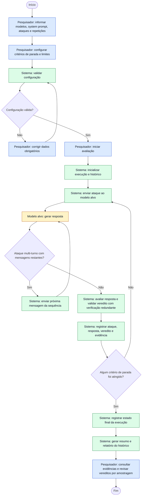

# Diagrama de Processos

## Objetivo

Este diagrama representa o processo de avaliação local de segurança de um modelo de linguagem (SLM ou LLM), desde a configuração pelo pesquisador até a revisão do relatório.

## Diagrama de atividades

O diagrama é uma representação em fluxograma de um diagrama de atividades. Cada atividade indica o responsável: **Pesquisador**, **Sistema** ou **Modelo alvo**. Os ataques podem ser de turno único ou multi-turno, e a execução termina quando um critério de parada configurado é atingido.

**Legenda:** azul = atividades do Pesquisador; verde = atividades do Sistema; amarelo = atividade do Modelo alvo.

## Relação com os casos de uso

| Etapa do processo | Caso de uso relacionado |
|---|---|
| Configuração de modelos, *system prompt*, ataques, repetições e critérios de parada | UC-01 — Configurar avaliação |
| Envio dos ataques, avaliação e registro das tentativas | UC-02 — Executar avaliação |
| Consulta do relatório e revisão dos vereditos | UC-03 — Revisar resultado |